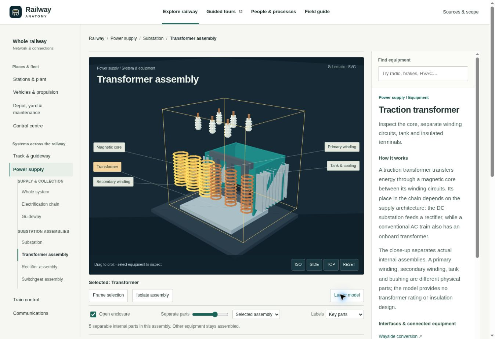
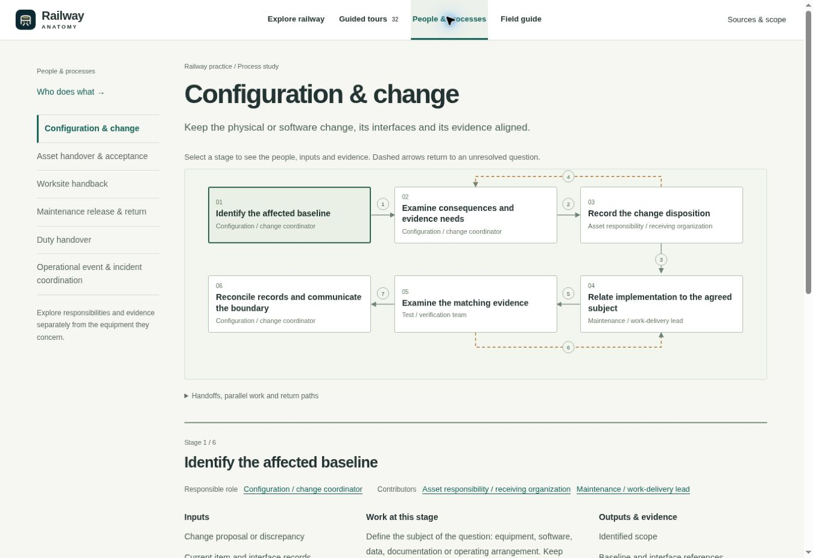
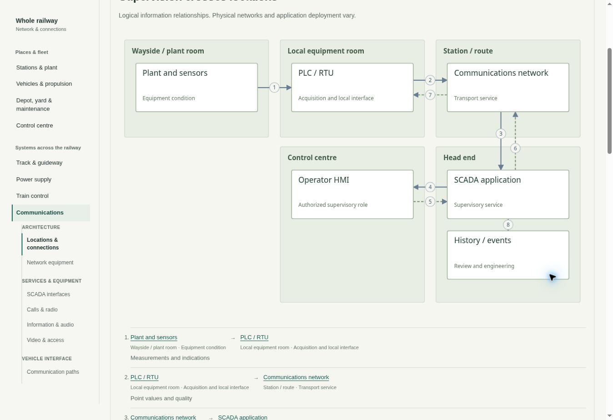

# Revision 6: equipment, connections, people and processes

Review date: 1 November 2026. This record describes the 6.0.0 source revision and the checks performed for it.

## What changed

The revision separates three questions that had become mixed together: how physical equipment is assembled, how information crosses the railway, and how people coordinate work. Each now has a representation suited to the question.

| Area | Result |
|---|---|
| Navigation | The whole railway remains the starting point. Places and fleet are separate from systems that cross locations. Equipment views are grouped within each system; process studies have their own top-level destination. Older process bookmarks redirect to the corresponding 2D study. |
| People and processes | Six interactive process maps cover configuration/change, asset handover, worksite handback, maintenance release, duty handover and incident coordination. Their 31 stages identify inputs, representative responsibilities, work, evidence and unresolved questions. Incident coordination shows parallel contributions. Twelve role descriptions connect control-centre, station, onboard, depot, engineering and maintenance work. |
| Train control | Conventional signalling, CBTC/urban ATC and ETCS are presented as related families. Shared functions and detection devices are distinguished from architecture and supplier examples. GoA comparisons describe changes in responsibility without inferring a station staffing level. |
| Electrification | Fourth-rail DC, third-rail DC, overhead DC and overhead AC are separate choices. They replace collection, supply, conversion and return hardware together, independently of propulsion and train control. Relevant equipment links select a compatible arrangement. Independent component-detail views preserve the wider railway choice. |
| Substation detail | Transformer, rectifier and switchgear views expose authored internal parts: core and windings, tank and terminals, semiconductor stacks and cooling, busbars, breaker poles, drive and the DC arc chute. Separation moves registered internals while retaining the assembly reference. |
| Communications | Six views cover locations/connections, network equipment, SCADA, voice, passenger information/audio, and video/access. The 2D view names endpoint locations, information exchanges and user roles; equipment views expose the physical interfaces. Reciprocal paths have distinct lanes. A complete connection list also serves narrow screens and keyboard access. |
| Station equipment | Added or deepened network, supervisory, help-point, information/audio, video/access, ventilation and fire-panel assemblies. Examples expose items such as optical modules, I/O, amplifier and speaker, lens and storage, access relay/contact, fan/motor, damper/gear, AHU filter/coil and panel batteries. |
| OCC and depot | Control-room furniture remains in place when the activity changes. Representative people appear in selected workplaces. Coordination and release content links to process maps rather than appearing as room equipment. Existing depot inspection, servicing, maintenance and workshop studies remain connected. |
| Motion | Playback is offered only for an authored mechanism or exchange. Generic whole-depot motion is removed. Meaningful examples include separate command/response/feedback states, rotating or moving mechanisms, and the fixed/mobile wash arrangement. Motion guides explain what the changing state represents. |
| Labels and framing | Labels use stable component anchors and balanced side positions, with collision clearance and fewer simultaneous tags on smaller screens. The internal-part count distinguishes useful separation from merely displacing a complete assembly. |
| Learning | The 32 guided tours were reviewed for their action, visible evidence, question and feedback. Supply-sensitive lessons choose their electrical arrangement explicitly. The door scenario now says “Door closure not confirmed” and explains missing closed-and-locked confirmation. |
| Project introduction | The README and in-app introduction explain public knowledge sharing, graduate/newcomer learning and the invitation to contribute. Contribution guidance and correction/addition issue forms describe useful feedback and public-source expectations. |

## Review images

The equipment screenshot uses the SVG compatibility renderer in the review browser. It shows the same authored scene geometry; it is not evidence of a hardware WebGL rendering test.

### Separate actual transformer internals

### Keep processes in their own representation

### Trace communications across locations

## Verification performed

`npm run reading` regenerated the static directory from the current catalog: **312 concepts and 172 source records**. These are content records, not a claim that every linked publication is freely available in full.

The complete `npm run check` suite passed. It includes module parsing, local dependencies, content/source references, guided-tour actions, scene construction and reachable model anchors, technology and architecture boundaries, depot and OCC invariants, exploration, label clearance, process content, electrification, communications and station equipment.

Focused evidence includes:

- 294 view/variant/mode routes, 40 vehicle configurations, 8 electrical/propulsion bookmarks and 31 process-stage routes, plus legacy redirects and history restoration.
- 60 technology scene combinations, 28 track/signalling/platform variants, and 48 electrification view/profile/propulsion cases using the production scene builders.
- 19 depot, 11 OCC, 12 connected-study, 7 people/process and 17 communications/station checks.
- Actual process-menu resize dispatch at 390, 740, 741 and 1280 px without changing the active route.
- A final regression for selecting DC switchgear, a breaker or an arc chute from an AC scene, including preservation of the stored railway profile when using the independent switchgear-detail view.

The browser review inspected the overhead-AC chain, transformer cutaway/separation, communications connections, process diagram and responsive process navigation. The desktop review viewport was approximately 1348 × 926 px. Responsive frames were checked at 375 and 768 px outer widths, with content widths of 360 and 753 px after scrollbars; the inspected pages had no horizontal overflow. The phone communications list retained endpoint locations and roles.

The review environment did not provide WebGL, so the visual review used the SVG compatibility renderer. The geometry checks execute the production Three.js scene builders, but they do not replace a hardware WebGL visual/performance check or a complete device/browser accessibility audit. External-source records were checked for attribution and scope; the automated suite does not guarantee continued availability of every publisher URL.

## Public material and remaining depth

Published explanations use public references and original schematic material. Source cards retain the distinction between a public abstract, a product example, jurisdiction-specific guidance and a full publication. The process maps explain relationships and responsibilities without reproducing an organization's operating procedure or private project records.

This remains an introductory, growing atlas. The [next learning studies](LEARNING-ROADMAP.md) identify ten specific additions, including timestamp/quality through SCADA, shared-service availability, maintenance evidence and diagnosis, PA intelligibility, radio continuity, electrical section boundaries and change impact across interfaces. Each proposal names a learning question, a suitable representation and public research starting points.
