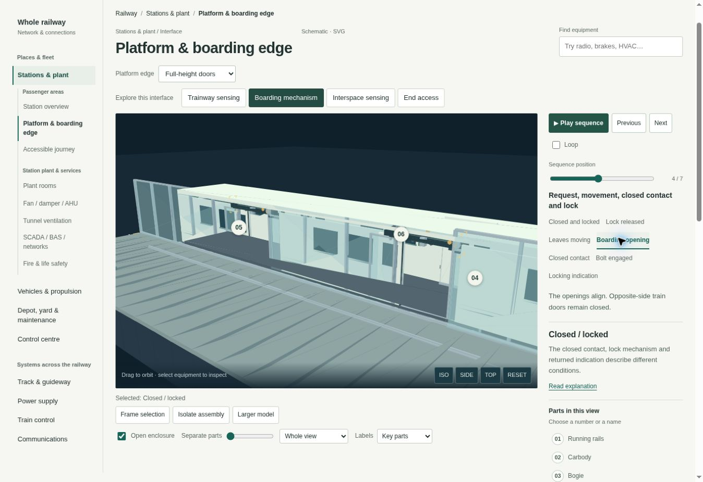
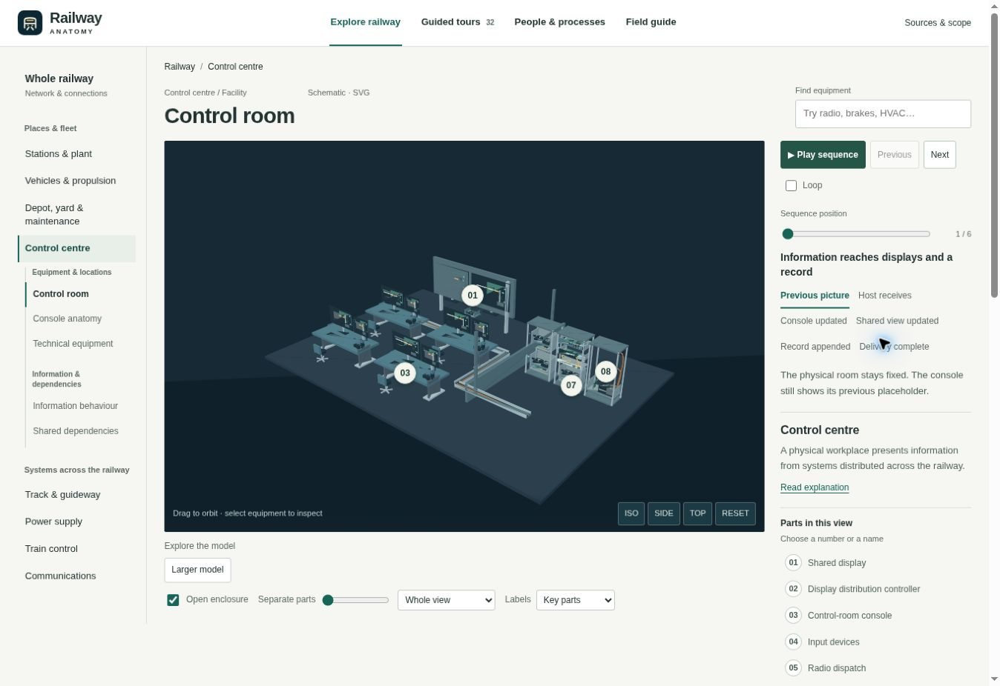

# Revision 7: inspect equipment and follow a sequence

Review date: 31 October 2026, Vancouver time. This record describes the 7.0.0 implementation and the design evidence reviewed for it. The focus is a clearer learning journey: locate an object, inspect its parts, change a meaningful condition, and read what the visible change demonstrates.

## Working view and sequence

The model or diagram now occupies the main working region. A compact selected-component readout gives its name, a short explanation and an explicit route into the complete technical text and public references. That text opens in normal page flow; it no longer occupies a permanent, independently scrolling narrow inspector.

On wide screens, the sequence, current caption and selected component sit in a compact rail beside the object. Narrow screens retain the model width and stack the supporting content. A nearby Play sequence control makes available motion discoverable before the reader reaches the complete sequence panel.

The authored-motion registry contains **56 guided animated view/variant states**. The count applies to combinations with an explanatory motion guide, rather than to all pages or components. Playback has a finite endpoint, pause and replay, optional looping, previous/next steps, clickable named stages, and a manual position control. A completed timed run and a manually selected endpoint use the same bounded phase. Reduced-motion preferences disable automatic playback while retaining manual inspection.

Numbered pins replace long floating labels and crossing leaders. Numbers identify components consistently within the current view and correspond to a readable parts key. Pins remain attached to projected equipment; crowded, occluded or offscreen anchors retain their key entry instead of being moved to a distant label gutter. Selecting a component, framing it, isolating its assembly and separating registered internals remain distinct actions.

## Station and platform choices

The platform study now separates three decisions:

| Decision | What changes |
|---|---|
| Physical edge | Open edge, half-height doors or full-height doors replace the boarding boundary. The station overview and focused platform study use the same selected arrangement. |
| Trainway sensor | LiDAR and paired radar are separate equipment examples. Selecting one replaces the other in the sensing study. |
| Study focus | Trainway sensing, boarding mechanism, interspace sensing and end access select the interface being explained. End access preserves the physical edge choice. Interspace explains its dependence on a fitted barrier. |

The contextual vehicle retains its platform-side doors. Its threshold, floor, platform surface and facade sills share the authored boarding datum, and doorway centres align. The boarding sequence distinguishes leaf travel, closed contact, bolt engagement and returned indication. The open-edge version has its own train-door sequence and does not describe a nonexistent platform-door lock. These are schematic mechanism explanations; they calculate no departure permission.

The station overview also gives passenger circulation and the equipment room deliberate spatial focus. The lift study distinguishes cabin movement, car doors and the two landing doors. The original geometry supports learning about relationships, without claiming a building layout, validated clearance, accessibility compliance or evacuation calculation.

The reviewed boarding capture shows the physical opening beside its selected stage and explanatory caption. The closer framing is intentional: the matching doorway interfaces remain the subject while the rest of the vehicle supplies context.

## Control centre: equipment, information and people

The control-centre hierarchy now distinguishes the room, console anatomy and technical equipment from information behaviour and shared dependencies. Physical studies expose equipment such as displays and their controllers, workstation input, radio dispatch, KVM interfaces, network and application equipment, cabinet parts and cable routes.

Information behaviour has a 2D-first representation with located endpoints, named exchanges, current endpoint states and a changing path. Request receipt, an independently observed field state, returned indication and the record are separate parts of the explanation. The illustrative ordering does not prove that a request caused a physical change, implement a railway command, or prescribe an operating procedure. An unavailable display or information path does not make the physical equipment disappear.

Roles and responsibilities, duty handover, incident coordination and other work processes remain in the dedicated People & processes destination. Their process maps and stakeholder explanations remain connected to the equipment without presenting responsibilities or work records as physical room furnishings.

## Electrical principles beside equipment anatomy

The transformer and rectifier studies now offer an Electrical principle representation alongside their physical equipment assemblies. The transformer links winding voltage, changing shared flux and an illustrative turns ratio. The rectifier connects the conducting phase pair, bridge path and AC/DC waveforms through one ideal cycle. Selecting a named stage updates the circuit and the quantitative illustration together.

The source records identify the teaching assumptions. The transformer uses normalized values and an ideal single-phase explanation; the rectifier assumes continuous conduction and zero source inductance. Losses, saturation, load dynamics and commutation overlap are outside these particular diagrams. The physical Equipment option still exposes the authored assembly and its internals. Public reading for these principles is recorded as EM01 and EM02 in the [source catalog](../dist/electrical-explainers.js) and generated [reading directory](../dist/reading.html).

## Why the side-rail composition was selected

Two materially different layouts used the same platform state and desktop viewport, approximately 1348 × 926 px:

| Candidate | Rendered evidence | Decision |
|---|---|---|
| [A: full-width model, supporting content below](review-v7/08-layout-a-sequence.jpg) | The large object is readable, but Play reaches the bottom of the first viewport and the named sequence explanation extends below it. | Retained as comparison evidence. |
| [B: model with a compact sequence rail](review-v7/09-layout-b-sequence.jpg) | The model remains approximately 808 px wide. Play, all seven stage labels, the current caption and the selected-part readout are visible together. | Selected for the wide-screen implementation. |

The selection is based on the discoverability of the learning action and the legibility of the actual equipment. It is an implementation review decision; end-user acceptance remains separate.

### Phone correction

The [first phone capture](review-v7/12-phone-platform.jpg) was a failed intermediate state: the final main-navigation item was clipped, a horizontal scrollbar appeared, and the model began too far down the page. The correction gives the four navigation items equal columns with wrapping labels, removes the duplicated Model view picker and makes equipment search a native disclosure on phones.

The after-capture shows all navigation destinations and no horizontal scrollbar. The model and nearby Play control begin about 74 px earlier in the review frame. Search remains available through Find equipment. Compact 2D endpoint cards retain selectable locations and the current exchange on narrow screens, with the complete message list available separately.

## Verification and limits

The complete `npm run reading && npm run check` release gate passed. It covers content and sources, route round trips, comparisons, geometry and mechanism contracts, OCC, depot, communications, electrification, processes and exploration. The focused interaction check also passed after final integration: **56 explained animated states**, finite/repeat playback, four crowded-pin viewport cases, the transformer voltage/flux relationship and six rectifier conducting intervals. See [check-interactions.mjs](../scripts/check-interactions.mjs).

Dedicated [station/platform checks](../scripts/check-station-platform.mjs) construct the shipping scene builders and inspect actual meshes, transforms and visibility. Their contracts cover independent physical choices, boarding datums, door motion and lock/indication distinctions. The wider geometry and navigation checks complement the browser review; source-level geometry contracts do not establish visual quality by themselves.

The browser captures in this record used the **SVG compatibility renderer**. Hardware GPU WebGL visual quality and performance have not been verified in this review environment. The screenshots support judgments about the observed composition and states; they do not establish every browser/device combination, every route, or a complete accessibility audit.

Integration review also corrected a profile-dependent sequence-button cache, focus loss when selecting a newly rendered parts-key item, a hidden explanation action during tours, and the absence of an immediately visible topology representation on phones. Playback now follows elapsed time even when the compatibility renderer draws slowly. Visible focus, native disclosures and manual sequence controls are part of the implementation.

Additional browser checks confirmed a 375 px phone content width with no horizontal overflow, selectable OCC endpoint cards with keyboard focus retained, returned-indication states and active message paths, and a 753 px tablet content width without horizontal overflow. The [OCC phone state](review-v7/17-phone-occ-state.jpg), [rectifier endpoint](review-v7/14-rectifier-after.jpg) and [lift at the upper landing](review-v7/19-station-lift-after.jpg) provide further rendered evidence. The lift capture shows the open upper doors and closed lower landing in their physical context.

## Public material

The published explanations, reading links and original schematic geometry use public material. Source cards distinguish general principles, supplier examples, jurisdiction-specific guidance and the accessible scope of abstracts or listings. A public listing does not imply access to the complete publication. No private project layout, quantities, identifiers, control sequences or interfaces are reproduced.

This remains a public learning project for newcomers and railway practitioners. Corrections and additions should identify the learning question, the affected view or component, and a public source that supports the proposed explanation.
