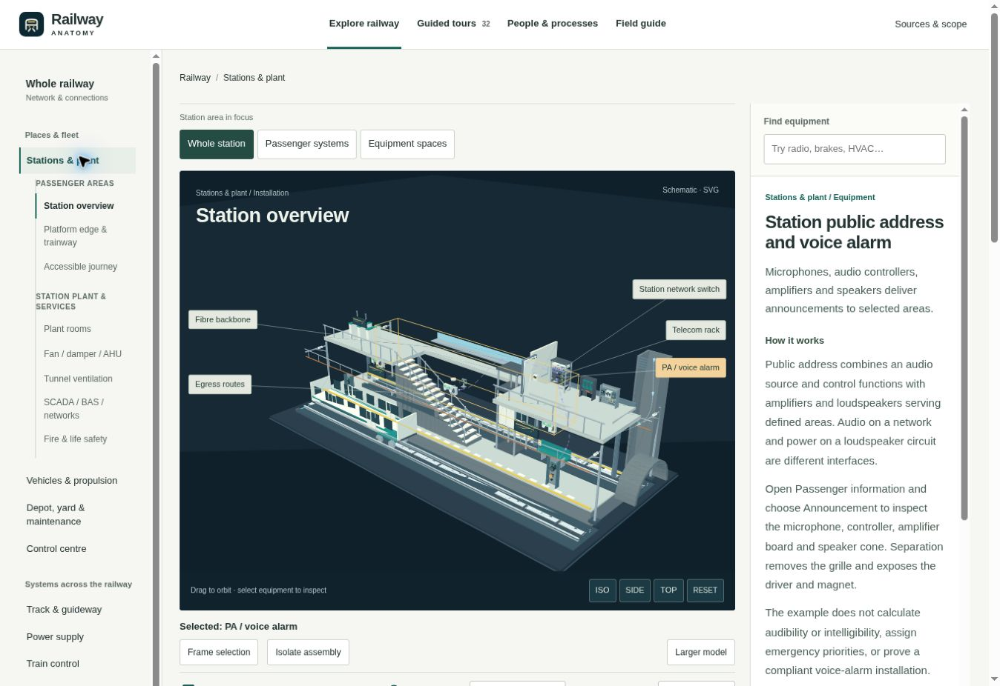
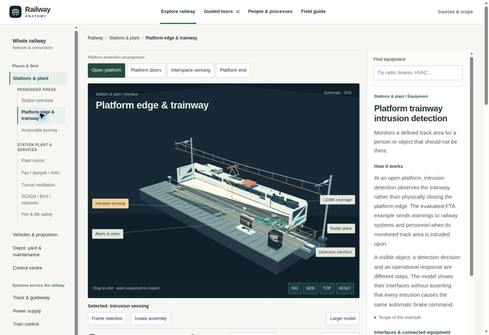
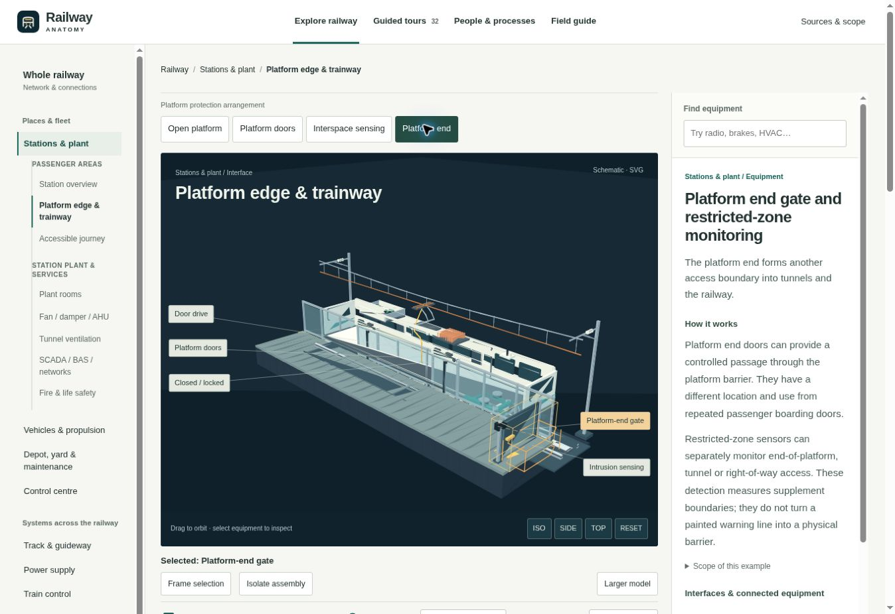
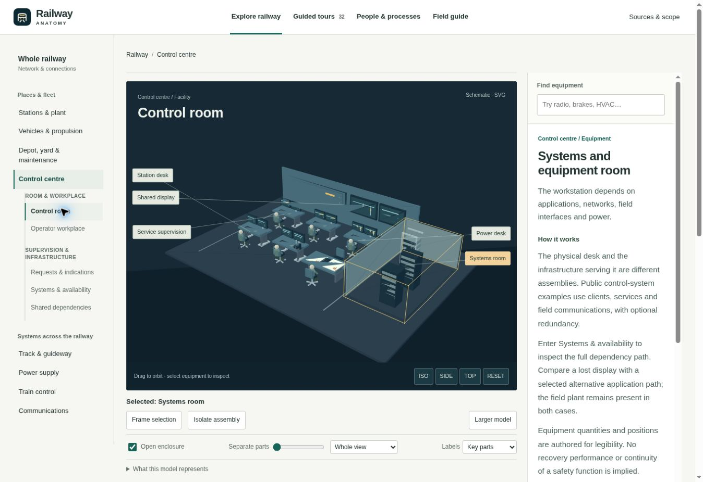
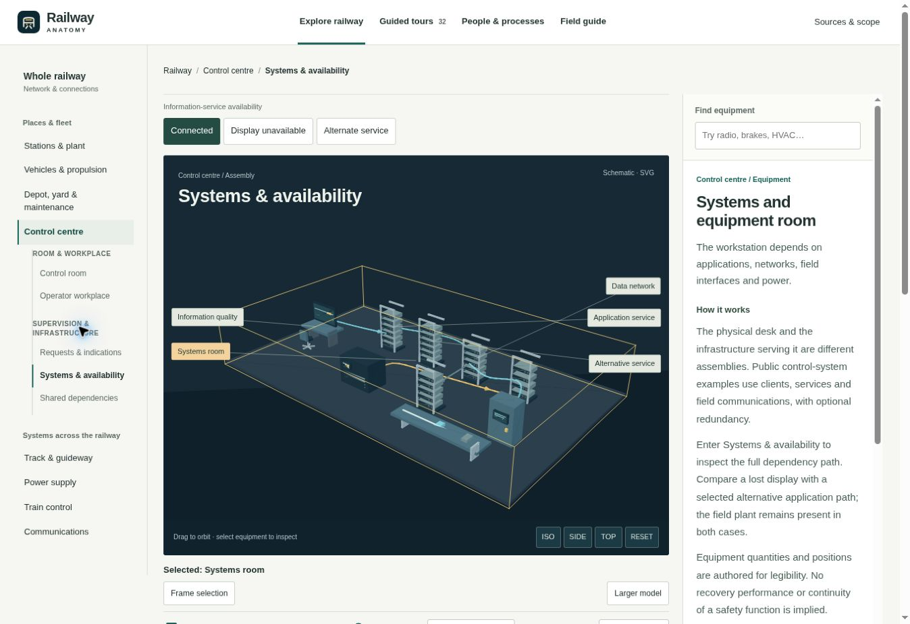
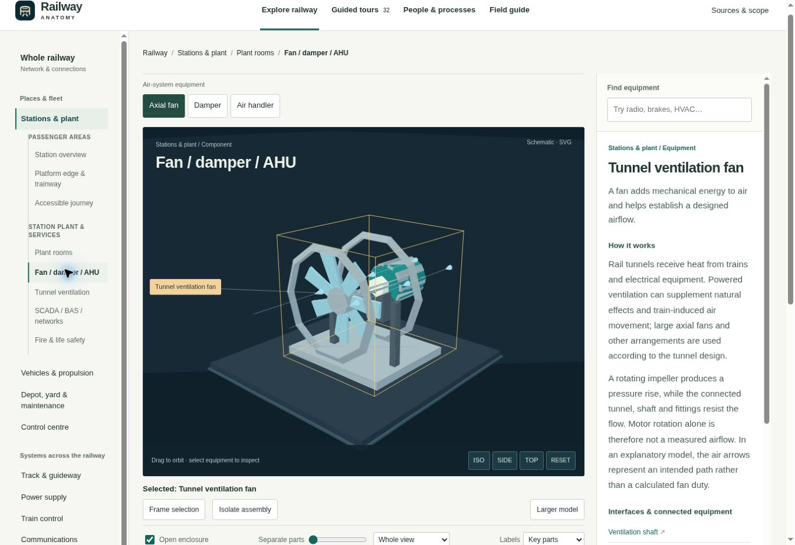
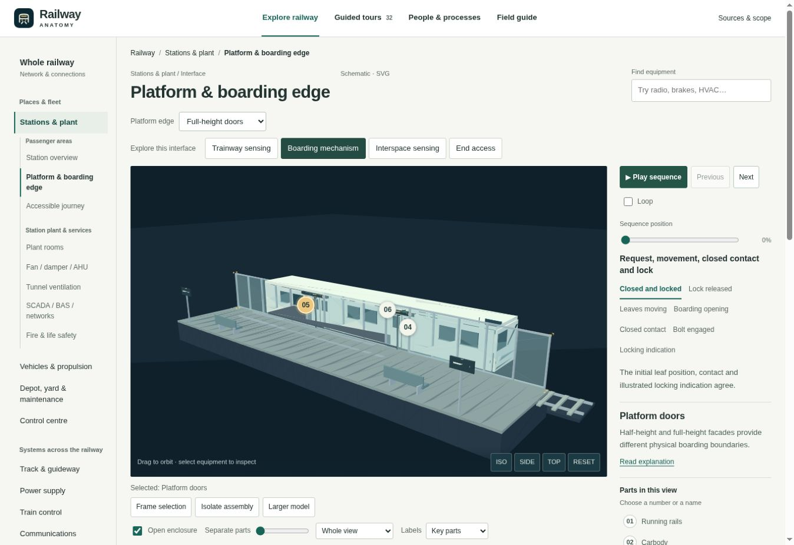
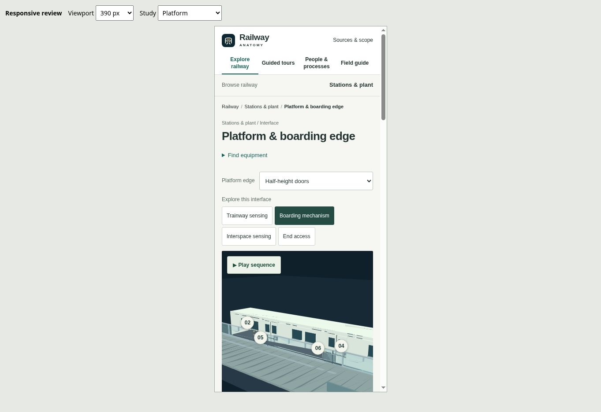

# Railway Anatomy: focused product review

Reviewed 31 October 2026, Vancouver time, against published commit `598f89d4c9715007b3504b779ff3833528ea8425`. These are new captures of the current release. The review follows the Product Design audit workflow: observe the user journey, capture the actual state, identify the learning obstacle, and verify the correction in the same journey.

## User goal and direction

A newcomer should be able to identify railway equipment in its physical context, see a meaningful change, and explain which interface carries the consequence. Equipment anatomy, information behavior, and people/process learning need distinct but connected representations.

The design direction is a working technical atlas: a large model or diagram, quiet navigation, a numbered parts key, a visible sequence with named states, and a full explanation available when requested. Engineering color belongs to the equipment and information being explained. A persistent narrow wall of prose should not compete with the working object.

## Current experience: six observed steps

### 1. Enter the station — useful hierarchy, crowded working region

The area/subsystem navigation is useful, but the model shares its width with a long independently scrolling explanation. The station contains many overlapping systems and the labels favor several nearby network items without explaining an overarching location story. The current station focus controls do not clearly frame the corresponding physical area.

**Correction:** give the working object more width; use a compact selection readout and explicit disclosure for the full explanation; improve circulation and device mounting, and frame passenger/equipment focus deliberately.

### 2. Inspect an open platform — inappropriate context and missing movement

The exposed train shell and overhead supply hardware compete with the platform interface. Remote processing/display equipment appears on the passenger slab. The normal journey does not expose a useful boarding or sensing sequence.

Source and geometry checks confirm that the cutaway removes the platform-facing train doors and that the platform, train floor and threshold use different heights.

**Correction:** use a closed contextual vehicle, a common boarding datum, aligned doorway locations, visible equipment supports and a separate service zone. Add sequences whose mechanism and feedback can be inspected manually.

### 3. Change to platform-end access — infrastructure changes unexpectedly

Selecting the end-area topic installs a continuous platform-door facade. The selector mixes an infrastructure alternative with a monitored volume and a physical location. The new facade is therefore a consequence of choosing a subject, rather than an explicit infrastructure choice.

**Correction:** separate the edge arrangement from study focus. End access preserves the edge choice. Interspace states explain their dependence on a barrier. LiDAR and radar are alternatives whose visible equipment changes deliberately.

### 4. Enter the control room — equipment and responsibilities remain mixed

The room provides a useful physical reference, but labels such as service supervision and power desk emphasize roles while the equipment hierarchy remains shallow. Role links and process subjects continue directly beneath the equipment view. Long leaders and a large selection cage compete with the room geometry.

**Correction:** organize the room around console, displays, communications, technical equipment and supporting services. Keep roles and process studies in their dedicated destination. Show physical assemblies and concise onward links.

### 5. Inspect systems and availability — logical behavior is staged as furniture

The view mixes equipment cabinets, application availability, information quality and a freestanding event table in one 3D arrangement. This makes it hard to distinguish a physical component from a displayed state or a logical service dependency.

**Correction:** provide a physical technical-room view and a separate, 2D-first information-behavior view. Named stages should show a request, a separately observed field state, returned evidence and the client/recording state. Hardware does not disappear merely because a display or data path becomes unavailable.

### 6. Inspect a ventilation mechanism — clear object, absent explanation through motion

The component is visible and inspectable, but playback is absent despite an existing rotating mechanism. The long single label and bounding cage dominate the close-up. Similar omissions occur in other mechanism views.

**Correction:** restore useful authored movement and align it with named stages and the manual scrubber. Add missing mechanisms where movement is needed to explain the subject. Keep motion optional, with pause, replay, manual steps and reduced-motion support.

## Cross-cutting priorities

1. Separate physical alternatives, study focus and demonstrated state.
2. Put the mechanism, diagram and visible state in the main working region.
3. Replace floating text and crossing leaders with stable numbered equipment identities and a readable key.
4. Make playback a finite, named explanation. Manual start, intermediate stages and end must agree with playback.
5. Keep full prose, public references and scope available without making every screen begin with dense reading.
6. Preserve the user’s orientation when navigating and make destination focus predictable.

## Accessibility and evidence limits

The captures show small label text and competing independently scrolling regions; they do not establish a complete accessibility result. Keyboard selection, focus restoration, manual phase control, reduced-motion behavior, narrow reflow and selected-state semantics require interaction checks after implementation.

The review browser uses the SVG compatibility renderer. Source inspection and production scene-graph measurements can establish visibility, placement and state relationships; they do not establish hardware WebGL performance. The final record must distinguish those checks from visual judgment and user acceptance.

Implementation decisions and matched after-captures are recorded in the final design evidence below.

## Final design evidence

The implementation was compared using the same platform subject, state and desktop viewport. The two candidates changed the composition of the working region rather than only its colours.

| Evidence | Observation and review decision |
|---|---|
| [08 — Candidate A](08-layout-a-sequence.jpg) | The full-width canvas makes the equipment readable, but the first viewport exposes only the start of the player. Named stages and the explanation are below the fold. |
| [09 — Candidate B](09-layout-b-sequence.jpg) | The approximately 808 px model remains readable while Play, all seven named stages, the current caption and the selected-component readout are visible together. The compact side rail was selected for wide screens. |
| [11 — Boarding mechanism](11-boarding-after.jpg) | The matching doorway interfaces are framed closely. The physical opening is visible beside the named opening stage and its caption. Edge arrangement remains an independent choice. |
| [13 — Control room](13-occ-room-after.jpg) | The fixed room and its equipment stay central, with numbered pins, a parts key, an explicit sequence and a concise selected-component readout. Full technical prose is available through a disclosure. |
| [12 — Phone, failed intermediate](12-phone-platform.jpg) | The final main-navigation item is clipped and a horizontal scrollbar appears. Search and the duplicated Model view selector delay the model. This capture is retained as a failed intermediate, not an accepted result. |
| [15 — Phone correction](15-phone-platform-after.jpg) | Four equal navigation columns wrap their labels; all destinations are visible and the horizontal scrollbar is gone. Search is a native disclosure and the duplicate view selector is removed. The model and Play action begin about 74 px earlier. This replaces 12 as the accepted phone composition evidence. |

### Selected composition

The wide-screen implementation uses a large model or diagram with a compact sequence and selected-part rail. On narrower screens the same content stacks while the object retains its width. A nearby Play action exposes meaningful motion without placing the full technical explanation above the model. The inspector is now a normal-flow disclosure, with no permanent narrow prose scrollbox.

Stable component numbers connect pins, the parts key and the component list. A pin that would overlap, fall outside the viewport or sit behind equipment remains accessible through the key. Pins do not use displaced long leader labels. Physical selection, camera framing, assembly isolation and registered internal separation retain distinct purposes.

### Interaction and representation corrections

The current registry has **56 guided animated view/variant states** with authored explanations. This count is limited to those animated combinations. Named steps, the current caption, manual seeking, finite playback, pause/replay and optional looping describe the same bounded sequence.

Station/platform alternatives now separate physical edge, sensing example and study focus. Control-centre equipment, 2D information behaviour and the dedicated people/process studies use different representations. Request receipt and independently observed field evidence remain distinct; the information trace does not establish a command's physical consequence. Transformer and rectifier principles have coordinated circuit/waveform explanations with explicit ideal-model assumptions.

Integration review found and corrected stale platform stage buttons after changing the edge, focus loss when a parts-key item was rebuilt, and a tour action that attempted to reveal hidden content. Narrow information diagrams now supply visible endpoint cards and the active exchange alongside the full-message disclosure. Selected compact cards have an explicit keyboard-focus outline.

### Evidence boundary

The focused interaction script passed with 56 explained animated states, finite/repeat playback, four crowded-pin viewport cases and the transformer/rectifier mathematical contracts. Production geometry checks inspect actual authored meshes and state changes. Those checks and the displayed screenshots answer different questions.

All equipment screenshots here use the SVG compatibility renderer. GPU WebGL appearance and performance were not reviewed in this environment. The comparison supports the selected implementation direction and the observed phone correction; end-user acceptance, complete accessibility coverage and deployment verification remain separate. Public references and original teaching geometry define the published content scope.
